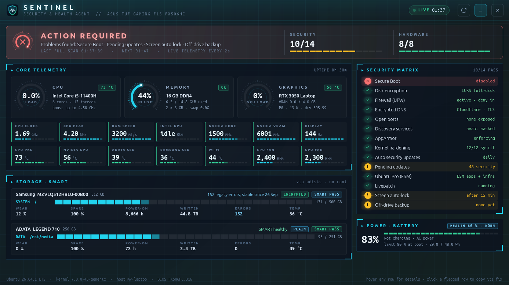
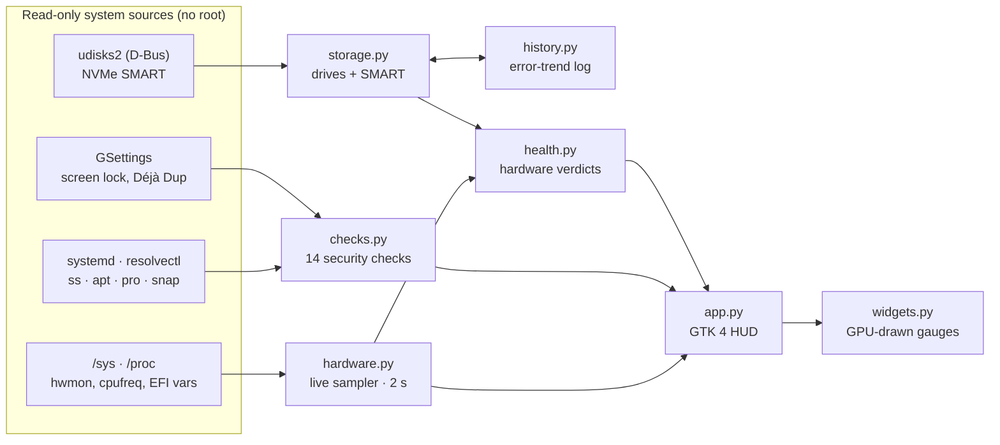

<div align="center">


# SENTINEL

### Your Linux laptop's security posture and hardware health, in one live HUD.

**14 real security checks · live CPU / GPU / RAM / SSD / battery telemetry · SMART error tracking · one-click fixes**
**No root. No daemon. No cloud. Nothing leaves your machine.**

[](#-installation)
[](#-requirements)
[](#-under-the-hood)
[](#-privacy--safety)
[](LICENSE)



<sub>A real capture from an ASUS TUF Gaming F15 running Ubuntu 26.04. Sentinel shows what it actually finds, so this machine still has items to fix.</sub>

</div>

---

## ⚡ Why Sentinel?

You hardened your Linux box once: firewall, encrypted DNS, AppArmor, kernel sysctls, auto-updates. **Is all of it still on today?**
An update can quietly revert a setting, a service can fail, and an SSD can start logging integrity errors without telling you.

Sentinel answers that the moment you open it. It **re-verifies every protection against the live system** and puts the
answer in one dark, glanceable heads-up display, next to real-time hardware telemetry.

> **Real status, never hardcoded green.** Every check reads the actual system state (sysfs, systemd, udisks, apt,
> resolved, UFW config). If something is off, Sentinel says so, explains why, and hands you the exact command to fix it.

---

## ✨ Features

### 🛡️ Security matrix: 14 live checks

| | Check | What Sentinel verifies |
|---|---|---|
| 🔐 | **Secure Boot** | UEFI Secure Boot state, read straight from EFI variables (`mokutil` fallback) |
| 💽 | **Disk encryption** | Walks the root file system's block chain to confirm it sits on **LUKS** |
| 🧱 | **Firewall (UFW)** | Enabled at boot, running, *and* default incoming policy is DROP/REJECT |
| 🌐 | **Encrypted DNS** | DNS-over-TLS active on **every** link in systemd-resolved |
| 🚪 | **Open ports** | Lists every TCP port exposed beyond loopback, with the program that owns it |
| 📡 | **Discovery services** | `cups-browsed` disabled and `avahi-daemon` masked |
| 🧬 | **AppArmor** | Kernel module loaded and profiles enforced |
| ⚙️ | **Kernel hardening** | 12 sysctl values: `kptr_restrict`, `dmesg_restrict`, ptrace scope, link protection, no ICMP redirects, SYN cookies… |
| 🔄 | **Auto security updates** | `unattended-upgrades` configured and its timer enabled |
| 📦 | **Pending updates** | Counts waiting security and regular updates |
| 🏢 | **Ubuntu Pro (ESM)** | Attached, with `esm-apps` and `esm-infra` enabled |
| 🩹 | **Livepatch** | Daemon running; diagnoses unconnected snap interfaces when it isn't |
| 🔒 | **Screen auto-lock** | Lock enabled and idle delay of 5 minutes or less |
| 💾 | **Off-drive backup** | Last Déjà Dup backup within 30 days, plus the Timeshift schedule |

**Hover** any row to see exactly what was checked. **Click** a flagged row to copy its fix command to the
clipboard, ready to paste into a terminal.

### 📊 Core telemetry, refreshed every 2 seconds

- **CPU**: load, average and peak clock, package temperature, governor and EPP. Hover the CPU card for a
  **per-core breakdown** of load, hyper-thread loads, clock and temperature for every core.
- **Memory**: usage, swap, and installed modules (size, DDR type, speed, maker) read from DMI without root.
- **Graphics**: NVIDIA load, VRAM, clocks, temperature, power draw and P-state; Intel iGPU live clock.
  **Never wakes a sleeping discrete GPU**: Sentinel checks the PCI runtime power state first and backs off so
  on-demand PRIME laptops stay cool and save battery.
- **Thermals and fans**: CPU, GPU, every NVMe SSD and the Wi-Fi card, plus fan RPM from ASUS, ThinkPad, Dell
  and HP platform drivers.
- **Display**: refresh rate, resolution and scale of the current monitor.

### 💽 Storage SMART health with error-trend tracking

For each NVMe drive: wear, spare blocks, power-on hours, total data written, integrity errors, temperature and
encryption, read through **udisks over D-Bus without root**.

Sentinel keeps a small history (`~/.local/state/sentinel/history.json`) so it can tell **old errors from new ones**:

- 🟦 *152 legacy errors, stable since 26 Sep* is a past event, so it is only noted
- 🟥 *integrity errors rising: +3 since 26 Sep* means the drive is deteriorating, so back up now

It also scans the current boot's kernel log for NVMe and I/O errors.

### 🔋 Power and battery

Charge, AC state, live power draw, charge-limit threshold, and **battery health** (current versus design
capacity in Wh), with a wear verdict.

### 🎯 One verdict, two scores

The banner sums everything up: **ALL SYSTEMS SECURE**, **PROTECTED · N TO REVIEW**, or **ACTION REQUIRED**,
with a **SECURITY x/14** and **HARDWARE x/y** score.

---

## 🔒 Privacy & safety

- **No root, ever.** Everything comes from files and APIs that a normal desktop user can already read.
- **No telemetry.** Sentinel sends no data anywhere: no analytics, no accounts, no phoning home.
- **No background service.** It runs only while its window is open. No autostart, no daemon, no cron job.
- **Read-only.** Sentinel never changes your system. Fixes are copied to your clipboard for *you* to review and run.
- **Hardware-friendly.** It reads NVMe temperatures only every 10 s and the NVIDIA GPU only when it's already
  awake, so it doesn't keep hardware out of power-saving states.

---

## 🚀 Installation

### Requirements

- **Ubuntu 24.04 LTS or newer** (or another distro with **GTK 4.14+** and **libadwaita**) on the GNOME desktop
- Python 3 (preinstalled on Ubuntu)

### 1. Get the code

```bash
git clone https://github.com/hossainmdtanvir/sentinel.git ~/Projects/sentinel
cd ~/Projects/sentinel
```

### 2. Install the dependencies (once)

```bash
sudo apt update
sudo apt install -y python3-gi gir1.2-gtk-4.0 gir1.2-adw-1 python3-psutil
```

Everything else Sentinel reads from (udisks, UFW, systemd, apt, mokutil) already ships with Ubuntu Desktop.

### 3. Add the app launcher and desktop icon

```bash
./install.sh
```

The script checks your requirements first, then adds **Sentinel** to the app grid and puts an icon on the desktop.
If double-clicking the desktop icon does nothing, right-click it → **Allow Launching** once.

### 4. Launch

Search **Sentinel** in the app grid, double-click the desktop icon, or run it from a terminal (useful to see error output):

```bash
cd ~/Projects/sentinel && python3 -m sentinel
```

> 💡 **Recommended:** add yourself to the `adm` group so Sentinel can scan the kernel log for drive errors:
> `sudo usermod -aG adm $USER`, then log out and back in.

### Update · move · uninstall

```bash
git pull                              # update to the latest version
./install.sh                          # re-run after moving the folder (launchers point to its path)
./install.sh --uninstall              # remove the launchers
rm -rf ~/.local/state/sentinel        # optional: delete the SSD history log
```

📖 **More detail:** [INSTALL.md](INSTALL.md) covers setting it up on another laptop, every check's fix, and troubleshooting.

---

## ⌨️ Usage

| Action | How |
|---|---|
| Rescan everything | **Ctrl+R**, **F5** or the ⟳ button |
| See what a check verified | Hover the row |
| Copy a fix command | Click a flagged (yellow or red) row, then paste in a terminal with **Ctrl+Shift+V** |
| Per-core CPU details | Hover the CPU card |
| Close | **Esc**, **Ctrl+W**, **Ctrl+Q** or ✕ |

- **Live telemetry** refreshes every **2 s**.
- The **full security and SMART scan** runs on launch, every **10 minutes**, and on demand. You can watch the
  matrix fill in row by row.
- Launching Sentinel again brings the open window back and triggers a rescan instead of opening a second copy.

### Status colors

| Badge | Meaning |
|---|---|
| ✓ green | Protected / healthy |
| i blue | Informational, worth knowing, nothing to do |
| ! amber | Review: works, but below the recommended setting |
| ✕ red | Action required |

---

## 🖥️ Hardware support

Sentinel adapts to the machine it runs on and hides tiles for hardware you don't have.

| Component | Support |
|---|---|
| CPU | Intel (`coretemp`) and AMD (`k10temp`, `zenpower`): load, clocks, per-core temperatures |
| NVIDIA GPU | Full telemetry via `nvidia-smi` (needs the proprietary driver: `sudo ubuntu-drivers install`) |
| Intel iGPU | Live clock and RC6 idle state |
| AMD GPU | Listed; no live sensor yet |
| NVMe SSDs | Full SMART, temperature, encryption, error trend |
| SATA SSDs | Usage and encryption; SMART shown as unavailable |
| Fans | ASUS, ThinkPad, Dell SMM, HP and other hwmon fan drivers (up to two) |
| Wi-Fi | Intel (`iwlwifi`) and MediaTek (`mt7xxx`) card temperature |
| Battery | Charge, health, wear, charge limit; desktops show **AC ONLY** |

---

## 🧠 Under the hood



- **Pure Python + GTK 4 / libadwaita.** The only dependency outside the GNOME stack is `psutil`.
- **Non-blocking.** Sampling and scanning run on worker threads; results are applied on the GTK main loop, so the
  UI never stutters.
- **GPU-rendered gauges.** The ring gauges and LED bars draw through GTK's own renderer (`Gsk.PathBuilder`) with
  eased animations, so there's no cairo dependency.
- **Fault-tolerant.** A check that crashes shows as *error* instead of taking the window down, and one odd sensor
  reading never stops the live loop.

### Project structure

```
sentinel/
├── README.md          you are here
├── INSTALL.md         detailed install, fix and troubleshooting guide
├── install.sh         creates (or removes) the app-grid entry and desktop icon
├── LICENSE            MIT
├── assets/
│   └── sentinel.svg   app icon
├── docs/
│   └── screenshot.png
└── sentinel/          the app
    ├── __main__.py    entry point: python3 -m sentinel
    ├── app.py         window, layout, live loop and scan orchestration
    ├── checks.py      the 14 security checks + kernel-log drive check
    ├── hardware.py    live CPU / RAM / GPU / fan / temperature / battery readings
    ├── storage.py     drive layout, LUKS detection, SMART via udisks
    ├── health.py      hardware health verdicts and thresholds
    ├── history.py     SSD error-trend log
    ├── widgets.py     animated ring gauge and segmented bar
    └── style.css      the HUD theme
```

---

## 🛠️ Troubleshooting

| Problem | Fix |
|---|---|
| `install.sh` says requirements are missing | Run the `apt install` command from step 2 |
| `Namespace Adw not available` / `No module named 'psutil'` | Same: step 2 |
| `AttributeError` mentioning `PathBuilder` or `get_scale` | GTK is too old: use Ubuntu 24.04 or newer |
| Desktop icon does nothing | Right-click → **Allow Launching**, or run `python3 -m sentinel` in a terminal to see the error |
| "Drive I/O log: unreadable" | `sudo usermod -aG adm $USER`, then log out and back in |
| NVIDIA tiles missing | Install the driver: `sudo ubuntu-drivers install` |
| Window taller than the screen | Resize it; the content scrolls |

---

## 🤝 Contributing

Issues and pull requests are welcome, especially:

- support for more distros (Fedora's `firewalld`, `dnf-automatic`, …)
- AMD GPU and SATA SMART telemetry
- additional hardening checks

Please keep the core principles: **no root, no network, read-only, real status only.**

## 📄 License

[MIT](LICENSE) © Md Tanvir Hossain

<div align="center">
<sub>Built for people who want to <i>know</i>, not hope, that their machine is protected.</sub>
</div>
